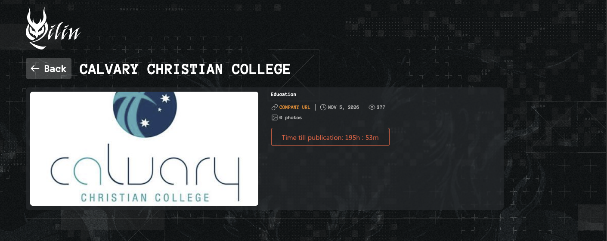

This entry in **North Queensland Cyber Watch**, the series looking at cyber security incidents that affect our region and what organisations here can take from them, is being written within hours of the event, so it needs a careful first sentence.

What has happened is that the criminal ransomware group **Qilin** has **named Calvary Christian College** on its leak site, as [recorded by ransomware.live](https://www.ransomware.live/id/Q2FsdmFyeSBDaHJpc3RpYW4gQ29sbGVnZUBxaWxpbg){:target="_blank" rel="noopener noreferrer"} on the evening of 5 November 2026. The college is the [independent co-educational school at Mount Louisa](https://www.calvary.qld.edu.au/about-us){:target="_blank" rel="noopener noreferrer"} in Townsville. A listing is a claim by criminals, not a confirmed breach. When I checked about half an hour later, and again about three hours later, the school had said nothing publicly, and I could find no police or regulator statement and no news report. Calvary Christian College is **not accused of any wrongdoing**, and on the current public record it is as much a potential victim as its students, families and staff are.

*Photo by [Far Chinberdiev](https://unsplash.com/@fardevio?utm_source=unsplash&utm_medium=referral&utm_content=creditCopyText){:target="_blank" rel="noopener noreferrer"} on [Unsplash](https://unsplash.com/photos/bookshelves-in-bright-library-interior-pKSshORDmCQ?utm_source=unsplash&utm_medium=referral&utm_content=creditCopyText){:target="_blank" rel="noopener noreferrer"}.*

## What has been reported

[ransomware.live's victim page](https://www.ransomware.live/id/Q2FsdmFyeSBDaHJpc3RpYW4gQ29sbGVnZUBxaWxpbg){:target="_blank" rel="noopener noreferrer"} records an entry for **Calvary Christian College** (www.calvary.qld.edu.au), attributed to **Qilin**, in Australia, with a **discovery date of 5 November 2026 (09:14 UTC, 19:14 AEST)** and an **estimated attack date of 5 November 2026**. The tracker's structured record classifies the victim in the Education sector. The entry's description field reads "N/A", and the tracker records no data volume or ransom amount.

{: width="700" }
_The Qilin listing as it appeared on the evening of 5 November 2026. Screenshot retained for reporting and commentary; the leak site is not linked._

The listing itself is thin. It shows the college's name and logo, the sector, the date and a **countdown reading "Time till publication: 195h : 53m"**, a little over eight days, the usual pressure tactic of threatening to publish unless the victim pays. It also shows **"0 photos"**: when it was captured, the group had posted no sample documents. As far as I could find, the group has **not said what data it holds or how much**. A countdown is a threat, not evidence that any data exists.

This is the Townsville school. The listed domain, calvary.qld.edu.au, belongs to the college at 569 Bayswater Road, Mount Louisa, whose [homepage](https://www.calvary.qld.edu.au/){:target="_blank" rel="noopener noreferrer"} describes "Calvary Christian College, Townsville" as a co-educational independent school from its Early Learning Centre through to Year 12, and whose [About Us page](https://www.calvary.qld.edu.au/about-us){:target="_blank" rel="noopener noreferrer"} puts enrolments at over 1000 students. The Queensland Department of Education's [schools directory](https://schoolsdirectory.eq.edu.au/Details/5884){:target="_blank" rel="noopener noreferrer"} lists it as an independent non-state school, Prep to Year 12, in the North Queensland education region. It should not be confused with the [Calvary Christian College in Logan](https://calvarycc.qld.edu.au/){:target="_blank" rel="noopener noreferrer"}, which has campuses at Carbrook and Springwood and uses a different domain. Nothing in the listing refers to the Logan school.

I checked the college's own website on **5 November 2026 at about 19:45 AEST** (09:45 UTC), and again at about 22:12 AEST. Neither the [homepage](https://www.calvary.qld.edu.au/){:target="_blank" rel="noopener noreferrer"} nor the [News & Events page](https://www.calvary.qld.edu.au/news){:target="_blank" rel="noopener noreferrer"} carried any cyber-incident, ransomware, outage or data-breach statement on either check, and nor did the [About Us page](https://www.calvary.qld.edu.au/about-us){:target="_blank" rel="noopener noreferrer"} at 19:45.

At 19:45, other public trackers had not yet picked the listing up. By 22:12 AEST, [SOCRadar's ransomware-intelligence page for the listing](https://socradar.io/free-tools/ransomware-intelligence/victims/calvary-christian-college-qilin-0f794665){:target="_blank" rel="noopener noreferrer"} showed the college under Qilin, in Education, Australia, with the status **"Claimed"**. [CyberStack's Australian ransomware register](https://cyberstack.org/ransomware/group?name=qilin&c=AU){:target="_blank" rel="noopener noreferrer"} still did not list it among its Qilin entries, and at 19:45 there was no matching entry on [Webber Insurance's list of Australian data breaches](https://www.webberinsurance.com.au/data-breaches-list){:target="_blank" rel="noopener noreferrer"}. Web searches for the college's name with "cyber", "ransomware", "data breach", "hack" and "Qilin", run at both times, returned no report from the ABC, the *Townsville Bulletin*, Cyber Daily or iTnews. That is not surprising for a listing only a few hours old, and it is not evidence either way.

## What is reported, claimed and still unknown

As with the [All Souls St Gabriels School entry]() last month, the responsible way to read this is to keep three categories apart.

- **Reported:** A public ransomware tracker, [ransomware.live](https://www.ransomware.live/id/Q2FsdmFyeSBDaHJpc3RpYW4gQ29sbGVnZUBxaWxpbg){:target="_blank" rel="noopener noreferrer"}, has indexed a leak-site listing naming Calvary Christian College under Qilin, discovered on 5 November 2026, and by that evening [SOCRadar](https://socradar.io/free-tools/ransomware-intelligence/victims/calvary-christian-college-qilin-0f794665){:target="_blank" rel="noopener noreferrer"} showed it with the status "Claimed". When I checked that evening, the college's website carried no incident notice, and I found no news report.
- **Claimed by the group:** Qilin has posted the college's name and logo on its leak site, with a countdown to "publication" and no sample documents. That listing is **the group's claim, not a confirmed breach**. The group has not, as far as I could find, said what data it holds, how much, or where it came from.
- **Not established publicly:** whether the college's systems were actually compromised; whether any data was stolen or copied; what kinds of records, if any, were involved; how many students, families or staff might be affected; when any intrusion began; whether the college is working with Queensland Police, the Australian Signals Directorate's ACSC or the Office of the Australian Information Commissioner; and whether the college will confirm, deny or otherwise respond.

The All Souls case is a useful guide to how this tends to unfold. There, a leak-site listing came first, and a few days later the school [confirmed a cyber incident on the record](), while whether personal information had been taken remained unestablished. The [Townsville Christian College entry]() shows the other end of that line: a school's own notice to its community under the Notifiable Data Breaches scheme, saying what happened and what was involved. Nothing like either is on the public record here yet. Some listings turn out to be real incidents the victim is still working through; others turn out to be inflated or misattributed. Until the college publishes something, or police or a regulator confirm it, the honest position is that a criminal group has made a claim and we do not yet know if it is true.

## Who Qilin are

Qilin is not a new or small operation. [ransomware.live's group page](https://www.ransomware.live/group/qilin){:target="_blank" rel="noopener noreferrer"} says it was first observed in July 2022, that its ransomware is written in Golang, and that its operators practise double extortion: demanding payment for a decryptor, as well as for the non-release of stolen data. [The same page](https://www.ransomware.live/group/qilin){:target="_blank" rel="noopener noreferrer"} counts **2,563 victims** across 110 countries.

In Australia, [Cyber Daily reported on 27 October 2026](https://www.cyberdaily.au/security/14358-exclusive-qilin-ransomware-group-claims-quartet-of-aussie-victims-in-as-many-days){:target="_blank" rel="noopener noreferrer"}, in a story by David Hollingworth, that Qilin had claimed four Australian victims in four days, described it as a ransomware-as-a-service operation in which many different affiliates use the group's malware in return for a cut of the profits, and said it had listed more than 2,500 organisations since 2022, including 52 Australian organisations. One of those four, Bathurst RSL, [confirmed to Cyber Daily](https://www.cyberdaily.au/security/14358-exclusive-qilin-ransomware-group-claims-quartet-of-aussie-victims-in-as-many-days){:target="_blank" rel="noopener noreferrer"} that it was responding to a cyber incident; two others did not respond to Cyber Daily's request for comment, and the fourth had been deregistered years earlier. That mix is common, and it is why a listing on its own proves nothing about a particular victim.

The most useful material for organisations here comes from incident responders. Triskele Labs, an Australian digital forensics and incident response firm, [wrote in a June 2026 post](https://www.triskelelabs.com/resources/qilin-on-the-rise-what-australian-organisations-need-to-know){:target="_blank" rel="noopener noreferrer"} that in the nine Qilin incidents its team investigated, the group gained initial access through **exposed Remote Desktop Protocol (RDP) or SSL VPNs that had not been configured with multi-factor authentication**. [The same post](https://www.triskelelabs.com/resources/qilin-on-the-rise-what-australian-organisations-need-to-know){:target="_blank" rel="noopener noreferrer"} says Qilin's dwell time averages 19 days but that it has been seen to get in, find sensitive data, destroy backups and encrypt systems in as little as two days; that it uses legitimate remote-management tools such as AnyDesk, TightVNC, Splashtop and ScreenConnect to keep access; and that, like most ransomware groups, it is most active in the late evening and early morning Australian time, so that victims often found out only when staff arrived in the morning to encrypted systems.

None of that says how, or whether, anyone got into Calvary Christian College's systems. It describes how this group has typically operated elsewhere.

## Why a school's records matter

A K–12 school with an early learning centre holds a deeper and more sensitive record set than most organisations of its size: enrolment records and family contacts, custody and pick-up arrangements, medical, allergy and learning-support information, wellbeing notes and reports, fee and direct-debit details, and identity documents for staff, volunteers and contractors. Many of the people in those records are young children who cannot consent on their own behalf.

The [Canvas entry]() that opened this series made a point that applies here too: even names, email addresses and a school affiliation are enough for convincing follow-on phishing. A leak-site listing also gives scammers a story to tell, whether or not any data was actually taken.

## What families, students and staff should do

There is nothing to panic about yet. If you are a parent, student or staff member at Calvary Christian College, the sensible steps are:

- **Wait for direct contact from the college** before believing anything you read on a tracking site or social media. The college is the only party that can tell you whether your information is affected.
- **Be wary of unexpected emails, texts or calls that mention the incident.** Scammers can reference a public claim to sound plausible while asking for a "fee", a "verification" or a password. Treat any such message as a scam until the college confirms otherwise.
- **Do not act through links in an email or text.** If something claims to be from the college, phone the college on the number on its website, or open its app or portal yourself.
- **Never give a password, card number or one-time code to someone who contacts you.** A genuine breach notification will not ask for these.
- **If identity documents are later confirmed as involved** (a licence, passport or Medicare card), consider a free credit ban with the credit bureaus, and contact [IDCARE](https://www.idcare.org/){:target="_blank" rel="noopener noreferrer"} (1800 595 160), Australia's free national identity and cyber support service, for a plan tailored to you.
- **Report suspicious contact to [Scamwatch](https://www.scamwatch.gov.au/report-a-scam){:target="_blank" rel="noopener noreferrer"}**, and keep any direct notice the college sends you.

## The lesson for North Queensland organisations

This is the second North Queensland school to appear on a ransomware leak site in under a month. Whether or not this claim is confirmed, the responder findings above are a checklist, not a mystery. Nothing public says how, or whether, anyone got into this school's systems, so this is a prompt for everyone else, not a diagnosis of Calvary Christian College.

A useful review covers:

- **every remote way in**: VPN, RDP, remote-desktop gateways and supplier remote-support tools. Is each one behind multi-factor authentication, with no exceptions for service, legacy or contractor accounts?
- **your internet-facing edge**: firewalls, VPN appliances and any vendor system reachable from the internet, patched promptly when a fix is released, with someone accountable for doing it;
- **remote-management tools**: know which ones are approved, and alert when any other appears on your network;
- **after-hours monitoring**: if alerts fire at 2 am, who sees them before the morning?
- **backups**: at least one offline or immutable copy with separate credentials, and a full restore you have actually tested;
- **your data map**: which systems hold student, family, health and identity records, who can export them, and how long old records are kept;
- **an incident response and notification plan**: who decides, who notifies the OAIC, families and staff, and who speaks publicly, decided before an incident rather than during one.

The data map point is easy to underestimate. Publicly indexed data (Shodan and certificate-transparency logs, checked 5 November 2026) shows that Calvary Christian College, like most schools, runs on a mix of outside platforms: separate services for its website and enrolments, its learning portal, email and identity, and bulk email. Each supplier holds part of the school's records. That says nothing about this claim, but it is a reminder that your data map has to cover every supplier, not just the systems on your own network.

ASD's Australian Cyber Security Centre publishes the [Essential Eight](https://www.cyber.gov.au/business-government/asds-cyber-security-frameworks/essential-eight/essential-eight-explained){:target="_blank" rel="noopener noreferrer"} as a baseline for making systems harder to compromise, and the OAIC's [Notifiable Data Breaches](https://www.oaic.gov.au/privacy/notifiable-data-breaches){:target="_blank" rel="noopener noreferrer"} guidance sets out when an incident like this has to be reported. Neither is a substitute for knowing where your student and family data lives.

If your school or organisation wants an independent, practical look at remote access, edge devices, identity, Microsoft 365 hygiene, backups and incident readiness, [Suburban Secure works with organisations in Townsville](https://suburbansecure.au/cyber-security-townsville/){:target="_blank" rel="noopener noreferrer"} and [Cairns](https://suburbansecure.au/cyber-security-cairns/){:target="_blank" rel="noopener noreferrer"}. The review is designed as an independent second opinion: the findings belong to the organisation, and the organisation chooses who acts on them.

The accurate headline for now is narrow. A criminal ransomware group, Qilin, has **claimed** Calvary Christian College in Townsville as a victim on its leak site, and a public tracker has indexed that claim. The college has not confirmed a breach, I could find no police or regulator statement, and it is not known publicly whether any data was taken. That uncertainty is exactly why the useful response is not to wait for confirmation, but to go and check the remote-access paths this group is known to use.

---

## References

Calvary Christian College. (n.d.). *Homepage*, *News & Events* and *About Us* pages (no cyber-incident, ransomware, outage or data-breach statement). <https://www.calvary.qld.edu.au/>, <https://www.calvary.qld.edu.au/news> and <https://www.calvary.qld.edu.au/about-us> (checked 5 November 2026, 19:45 AEST; homepage and News & Events rechecked 22:12 AEST).

Queensland Department of Education. (n.d.). *Calvary Christian College (Mount Louisa) (5884)* (schools directory). <https://schoolsdirectory.eq.edu.au/Details/5884> (checked 5 November 2026).

Calvary Christian College (Logan). (n.d.). *Homepage* (Carbrook and Springwood campuses). <https://calvarycc.qld.edu.au/> (checked 5 November 2026).

Ransomware.live. (n.d.). *Calvary Christian College* (victim page; group Qilin; discovered 2026-11-05 09:14 UTC; est. attack date 2026-11-05). <https://www.ransomware.live/id/Q2FsdmFyeSBDaHJpc3RpYW4gQ29sbGVnZUBxaWxpbg> (checked 5 November 2026, 09:43 UTC).

Ransomware.live. (n.d.). *Qilin* (group page). <https://www.ransomware.live/group/qilin> (checked 5 November 2026, 09:43 UTC).

SOCRadar. (n.d.). *Calvary Christian College ransomware attack by Qilin* (ransomware intelligence; status "Claimed"). <https://socradar.io/free-tools/ransomware-intelligence/victims/calvary-christian-college-qilin-0f794665> (not indexed at about 09:47 UTC; listed when checked 5 November 2026, about 12:13 UTC).

CyberStack. (n.d.). *Qilin: Australia entries*. <https://cyberstack.org/ransomware/group?name=qilin&c=AU> (checked 5 November 2026, about 09:45 and 12:12 UTC; no Calvary entry either time).

Webber Insurance. (n.d.). *The complete list of data breaches in Australia*. <https://www.webberinsurance.com.au/data-breaches-list> (checked 5 November 2026, about 09:45 UTC).

Hollingworth, D. (2026, October 27). *Exclusive: Qilin ransomware group claims quartet of Aussie victims in as many days*. Cyber Daily. <https://www.cyberdaily.au/security/14358-exclusive-qilin-ransomware-group-claims-quartet-of-aussie-victims-in-as-many-days>

Grainger, R. (2026, June 17). *Qilin on the rise: what Australian organisations need to know*. Triskele Labs. <https://www.triskelelabs.com/resources/qilin-on-the-rise-what-australian-organisations-need-to-know>

Office of the Australian Information Commissioner. (n.d.). *Notifiable Data Breaches scheme*. <https://www.oaic.gov.au/privacy/notifiable-data-breaches>

Australian Signals Directorate, Australian Cyber Security Centre. (n.d.). *Essential Eight explained*. <https://www.cyber.gov.au/business-government/asds-cyber-security-frameworks/essential-eight/essential-eight-explained>

IDCARE. (n.d.). *Get support*. <https://www.idcare.org/>
