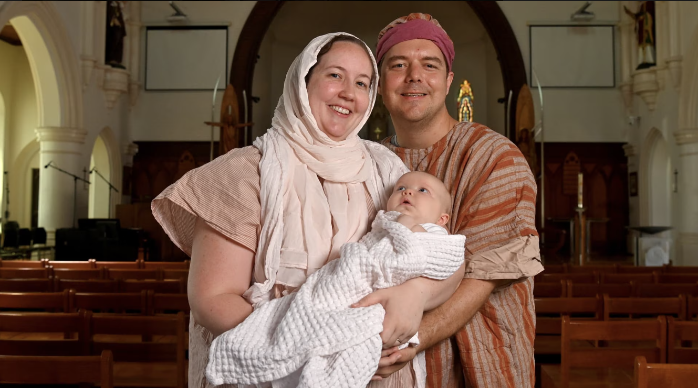

Our family has had a small part in the lead-up to **Stable in the City 2026**, with Sophie and me dressing as Mary and Joseph, and our three-month-old daughter Madeline joining us for a photoshoot at Sacred Heart Cathedral in Townsville.

It was a lovely opportunity to help The Stable NQ promote this year's event and to be involved together as a family. After years of helping with Stable in other ways, being in the photographs with Sophie and Madeline gives this Christmas a special connection for us.

The photos, taken by **Evan Morgan**, accompany Josh Mercer's *Townsville Bulletin* report, [*Stable in the City transforms Townsville CBD with four major festive event hubs*](https://www.townsvillebulletin.com.au/news/townsville/stable-in-the-city-transforms-townsville-cbd-with-four-major-festive-event-hubs/news-story/ba025c2f3587ac8a1ee8db12a37d4324). If you've spotted Sophie, Nick O'Sullivan and baby Madeline in the coverage, that's us!

## From behind the scenes to Mary and Joseph

Earlier this month, I wrote about [Christmas in Townsville 2026, Stable in the City and my memories of volunteering](https://blog.nickosullivan.id.au/2026/11/christmas-townsville-2026-stable-in-the-city/). That story includes setting up in the rain at the Strand, helping with media and promotions, and a Stable on the Strand television advertisement I produced in 2010.

I also mentioned the possibility of taking part as Mary and Joseph with our daughter. We have now had the chance to put on the costumes for this promotional photoshoot, helping share the invitation to Stable's next chapter.

For me, the reason for helping remains the same: sharing the story of Jesus' birth and the hope at the heart of Christmas. Being able to contribute with my own family makes that especially meaningful this year.

{: width="1329" height="741" }
*Inside Sacred Heart Cathedral with Sophie and Madeline for The Stable NQ photoshoot. Picture: Evan Morgan.*

## Stable in the City: four hubs for Christmas in Townsville 2026

The Bulletin's story outlines a new setting for a familiar Townsville Christmas tradition. Stable NQ and Uptown Townsville are bringing the celebration into the CBD, spreading the activities across four hubs and involving local churches, businesses and school students.

**Stable in the City runs from Thursday 3 to Saturday 5 December 2026, with all four hubs open from 5.30pm to 9pm each evening.** Here is a brief outline of what's planned:

| Hub | What to look out for |
| --- | --- |
| **YWAM Youth Precinct**, 312 Walker Street | The interactive Nativity Story, markets, food and entertainment at the main hub. |
| **St Andrew's Presbyterian Church and Townsville Central City Mission**, 119 Wills Street | Community carols, BMX and skate demonstrations, a petting farm and children's activities. |
| **Sacred Heart Cathedral**, 270 Stanley Street | Light projections, music, art and space for reflection at the cathedral where our photos were taken. |
| **Flinders Lane**, Flinders Street | Festive shopfront displays, including students' work, creative performances and a Gratitude Christmas tree. |

A shuttle will connect the hubs from the Dean Street car park. See [Stable NQ's official program, map and visitor information](https://stablenq.com.au/stable-in-the-city) for help planning your evening.

**The Nativity Story is free, but tickets are required.** Book a 30-minute arrival window through [Stable NQ's Nativity Story page](https://stablenq.com.au/the-nativity-story), which also has details of the dedicated Saturday afternoon session for older visitors and people with disability and their families.

*Event details checked on 12 November 2026. Follow the organiser's links for updates and bookings.*

## A family connection to Stable's next chapter

There are many people giving their time to make Stable happen. Our photoshoot is one small contribution, and I'm glad we could help introduce the event's new city setting.

If you're planning **Christmas in Townsville in 2026**, my [longer Christmas guide](https://blog.nickosullivan.id.au/2026/11/christmas-townsville-2026-stable-in-the-city/) brings together Stable's history, my volunteering memories and other local Christmas events. I hope it helps you find an opportunity to celebrate with your own family and community.

*Reporting credit: Josh Mercer, Townsville Bulletin, linked above. Both photographs: Evan Morgan.*
