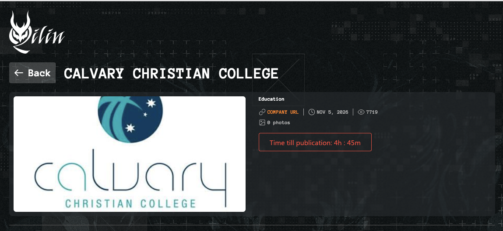

Today, **14 November 2026**, is the day Qilin's displayed countdown points to for publishing information it claims belongs to Calvary Christian College in Mount Louisa.

By the later check for this update, the counter on the group's own listing had passed **7,722 views**. Seeing a local school's name beside a countdown and that much attention is an uncomfortable moment. Behind the logo are children, families and staff who want to know what this means for them.

This follows my [5 November article on the Calvary listing](). There has been an important development since then: the college has confirmed a cyber incident, with its investigation identifying a permission-form system as the affected system.

**The deadline is a threat from a criminal group. This article does not confirm that a data release has occurred.** The screenshots captured for this update still show time remaining.

*File photograph by [Far Chinberdiev](https://unsplash.com/@fardevio?utm_source=unsplash&utm_medium=referral&utm_content=creditCopyText){:target="_blank" rel="noopener noreferrer"} on [Unsplash](https://unsplash.com/photos/bookshelves-in-bright-library-interior-pKSshORDmCQ?utm_source=unsplash&utm_medium=referral&utm_content=creditCopyText){:target="_blank" rel="noopener noreferrer"}. Used for illustration; it does not depict Calvary.*

## What has changed since the first post

In [David Hollingworth's report for Cyber Daily on 10 November](https://www.cyberdaily.au/security/14423-exclusive-townsville-s-calvary-christian-college-investigating-cyber-incident){:target="_blank" rel="noopener noreferrer"}, the college confirmed unauthorised access to part of its IT environment. It said its investigation had limited the incident to one system used for permission forms, with other school systems unaffected.

The college also said it had contained the incident and engaged independent cyber security, forensic and legal specialists. Cyber Daily reported that the ACSC and OAIC had been informed, and that the school would contact affected people directly.

That moves this story beyond an unconfirmed leak-site listing. It does not establish which records Qilin holds, whose information may be involved, or whether anything has been published. Those questions still need evidence.

## A countdown and more than 7,722 views

{: width="900" }
_The detail screenshot supplied for this update shows 7,719 views and 4 hours 45 minutes remaining. The later observed count had passed 7,722. These are the criminal site's own figures, not independently audited audience numbers. The leak site is not linked._

A view counter cannot tell us how many different people visited, who they were or whether anyone downloaded information. The zero-photo label does not establish that the group holds no files, either.

What the page does show is the pressure being applied to a school community. A countdown invites everyone to watch the clock, while families are left asking a much more personal question: is our information involved?

I would be careful about treating the expiry as a guaranteed publication time. The group controls the page and its claims. Whether the deadline passes quietly, changes, or is followed by a release, the school's investigation and support for affected people remain the important work.

## Does the organisation get a glimpse first?

It can. In its [account of human-operated ransomware investigations](https://www.microsoft.com/en-us/security/blog/2021/09/27/a-guide-to-combatting-human-operated-ransomware-part-2/){:target="_blank" rel="noopener noreferrer"}, Microsoft's incident response team describes extortion emails carrying sample stolen documents as evidence of possession.

That is one reason an organisation may know more than it can initially say publicly. A sample can help investigators check whether material is genuine, identify the system it came from and start assessing who needs help.

But a sample is only a sample. It cannot establish the full extent of access or theft, and the absence of someone's record from a small selection is no reassurance that their information is unaffected. Investigators still need to compare the material with the organisation's records and available logs.

**There is no evidence in the material reviewed for this article that Calvary received a private sample.** This is an explanation of how these incidents can unfold, not an account of private discussions at the college.

## If information is released, what can an organisation do?

For any school or organisation in this position, restoring systems is only part of the response. If information has been copied, bringing a server back online cannot retrieve those copies.

My priority would be to turn the investigation into useful, specific help for the people affected:

- **Establish what the material actually contains.** Have the response team assess its authenticity, the people involved and the risks. Preserve evidence securely and limit access to those doing the work.
- **Tell people what matters to them.** Explain which of their information is affected, what remains uncertain, what they should do and when the next update will arrive. A parent should not have to interpret a technical incident report.
- **Consider safety as well as fraud.** If sensitive family circumstances, addresses or health details are involved, the response may need individual support. These are examples of risks to assess, not confirmed categories in the Calvary incident.
- **Keep a reliable contact channel operating.** Give staff answering calls consistent information, and make it easy for families to verify a genuine notice. Include former students and staff if older records are affected.
- **Plan for continuing harm.** Monitor for misuse, update advice as findings change and arrange appropriate support. Removal from one website cannot establish that every copy is gone.

Notification decisions should follow the evidence and applicable obligations. For organisations covered by the Notifiable Data Breaches scheme, the [OAIC explains the assessment and notification requirements](https://www.oaic.gov.au/privacy/notifiable-data-breaches/when-to-report-a-data-breach){:target="_blank" rel="noopener noreferrer"}. An attacker publishing files is not a prerequisite for a breach to require notification.

Nor is paying a reliable way to recover control of information. The [ACSC advises against paying a ransom](https://www.cyber.gov.au/guidance/learn-about-ransomware){:target="_blank" rel="noopener noreferrer"}; payment does not guarantee recovery or prevent disclosure.

## What families and staff can do

Start with the college's direct advice, and verify unexpected messages through a phone number, app or portal you already trust. A caller knowing a child's name or school does not prove they are genuine.

There is no need to visit a criminal site to find out whether you are affected. Searching for, downloading or forwarding alleged school records risks spreading someone else's private information. If material is sent to you, report it privately to the school's response contact rather than passing it around a parent group.

The next steps depend on what information is actually involved. The [OAIC's guidance for people receiving a breach notification](https://www.oaic.gov.au/privacy/your-privacy-rights/data-breaches/respond-to-a-data-breach-notification){:target="_blank" rel="noopener noreferrer"} is a useful reference:

- For affected passwords, change them and any reused versions, and enable multi-factor authentication.
- For financial details, contact your bank through its usual channels and check transactions.
- For identity documents, ask the issuing agency what action is appropriate. If you suspect identity fraud, consider a credit-report ban with all three credit reporting bodies.
- Keep the notification and a record of the steps you take.

[IDCARE](https://www.idcare.org/){:target="_blank" rel="noopener noreferrer"} can help work through an individual response. For sensitive information that cannot simply be replaced, ask the school what support is available. A password reset cannot address every kind of harm.

These are precautions and possible responses, not a suggestion that every category above has been exposed at Calvary.

## A difficult year for North Queensland schools

Looking back through this series, I would very much like this to be the last school update I write in 2026.

In May, I covered [Townsville schools caught up in the Canvas incident](), a reminder of how much schools depend on outside platforms. In July, the [Townsville Catholic Education email-forwarding disclosure]() showed how an ordinary setting could create a serious privacy problem without a ransomware group being involved.

Then came [Townsville Christian College's ransomware response](), followed by [All Souls St Gabriels School's confirmation of a cyber incident]() in Charters Towers. Now Calvary is dealing with its own incident and a threatened publication deadline.

Those links preserve what was reported at the time. These are separate organisations and different incidents, with different levels of confirmed information. They should not be bundled into a claim that every school suffered the same attack or lost the same kinds of records.

What connects them is the responsibility schools carry for information about people who trust them. The effects can continue after lessons resume, systems recover and the public attention moves elsewhere.

## Is this it for the year?

I hope so. But there is no basis for calling an end to these incidents, or to the work of helping the people already affected.

Before the Christmas break, I would want every school leadership team to know who is watching security alerts during leave, who can act on them, whether a backup has actually been restored successfully, and how families will be contacted if normal systems are unavailable. I would also want a clear account of which suppliers hold school information and whether old records still need to be retained under the school's obligations.

Those are practical conversations to have while people are still available to have them.

For Calvary's community, I hope the coming updates bring clear answers and useful support. For everyone else, this is a good point to pause and look back at what North Queensland schools have dealt with this year, then check what we have changed in response.

The school year will finish. Looking after the information entrusted to a school carries on.

---

*Reporting note: This update is dated 14 November 2026 (AEST). It draws on the supplied deadline-day screenshots and later view-count observation, the college's statement reported by Cyber Daily on 10 November, and the linked guidance. No alleged stolen records were accessed for this article. Publication of a dataset, its contents and the number of affected people have not been independently verified.*
