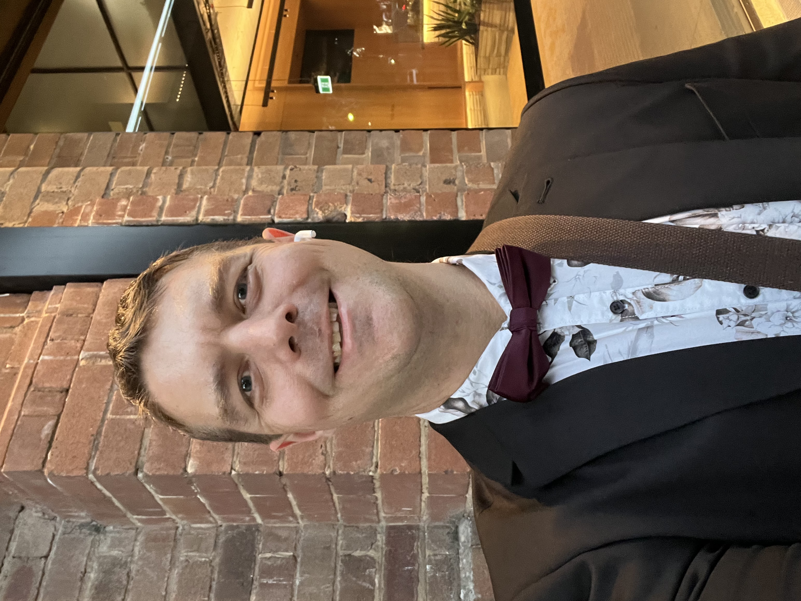

Born and raised in Townsville, Nick O'Sullivan has always enjoyed getting out and about. From riding along the Ross River to supporting local events, running small businesses and raising a family, there is a fair bit of his life tied up in this part of North Queensland.

With the ocean to the east, red-dust plains to the west and a beautiful tropical coastline stretching north and south, it is a place he has always called home.

Nick grew up in a family of four, with his parents and an older sister. He attended public schools across Townsville, from Currajong to the western suburbs, and spent plenty of time outdoors. Riding a bike was both something to enjoy and a way of getting around, often taking him well beyond his own neighbourhood.

“Growing up in Townsville, North Queensland, was an amazing opportunity,” Nick recalls.

“Being the only boy in the family, with an older sister, I would often get out for a ride along the Ross River and make my way from the suburbs to the beautiful Strand.”

He remembers a different Strand, with fewer cafés and the old Cold Rock ice-cream shop on the headland. Those rides, and the freedom to spend a day exploring, are still some of his favourite memories of growing up here.

By his senior years of high school, road cycling had become a particular interest. There were weights, boxing and runs around the neighbourhood in Kirwan too. His Year 12 jersey carried the nickname “The Machine”, which probably gives some idea of how much he enjoyed keeping active.

That interest also brought him into local sporting events. He supported the Paluma Push around 2008–2010 and Townsville Adventurethon in the years around 2012. In 2008, he organised a team of young athletes for the TP Human Capital Triathlon.

He was a young lad then, but the enjoyment of being involved and helping something happen has stayed with him.

## From dial-up internet to a career in IT

Alongside the bikes and outdoor activities, Nick had another hobby: computers and electronics.

Growing up on dial-up internet, then moving to a 1.5 Mbps ADSL connection and eventually ADSL2, gave him plenty to be interested in. Technology was changing, and he enjoyed learning about it.

His early working years included a call-centre tech support role while also operating local businesses, including Townsville Computer Man and GYMP Media. There was plenty to learn about both the technical work and the effort involved in keeping a small business going.

That experience is part of why he still makes a point of supporting people he knows.

“I'll even reach out to friends I've known since school and support their businesses, because I've been there and know just how hard it can be,” he says.

Over the years, his career has taken him from IT Officer to Regional Systems Technician and now IT Manager at an independent educational organisation. One of the things he enjoys most is seeing potential in someone starting out and helping them find their way into the field.

“I love seeing potential in an aspiring technical officer and supporting them in developing their career. I've often kept an eye on job advertisements and sent opportunities to people I've provided work experience to, to help them get into IT in Townsville.”

Finding the right opportunity locally can take patience. Nick knows that from his own experience, and it is something he has also written about in his reflections on [IT and cyber security careers in Townsville]().

“It's not always easy finding the right job in IT in Townsville, but occasionally the right opportunity will present itself. When it's tough, that's when you learn to dig in and get through it.”

<figure class="article-portrait">
  
  <figcaption>Nick O'Sullivan, a Townsville local whose interest in computers grew into a career in IT.</figcaption>
</figure>

## Getting involved and keeping in touch

Alongside work and business, Nick has spent many hours volunteering at community events. His involvement has included Townsville Enterprise's ambassador program during the early years of the local V8 Supercars event, volunteering with the Supercars and helping with Stable on the Strand.

“Aside from my business ventures, I would often dedicate countless hours to volunteering in community events. I've loved being part of it,” he says.

Stable has remained a connection over the years. More recently, Nick and his family took part in a [photoshoot for Stable in the City](), adding another memory to his years of helping with the Christmas event.

There are older connections too. Nick remembers long days fishing with his church's fishing club at Northreach Baptist Church, formerly Townsville District Baptist Church. Friendships made through church, school and time spent outdoors are still important to him today.

“I love reaching out to the friends I've had since my younger years,” he says.

“Being available and just willing to say g'day to someone you may not have seen for a long time, or someone you meet out in public, is a simple thing you can do to make someone's day.”

## Family, faith and a bit of time outdoors

These days, you will often find Nick in a long-sleeved shirt with an image of Townsville's Strand across it, spending time outdoors with his family or looking after the lawn.

“It's a hot place, Townsville, and you've got to dress for it. Long sleeves, sunscreen, adequate water, and I'll happily spend hours outdoors.”

As a husband, father and son, family is an important part of his life. So is making time to sit down together, have a conversation and enjoy a meal, whether that is a barbecue on a summer evening or a Christmas gathering with the neighbours.

The family's quiet Townsville court has hosted Christmas street parties, with Nick's contributions including a ham basted in ginger beer. An opportunity through Townsville City Council helped get the street parties started, and they became a chance for neighbours to spend a bit more time together.

“Our local court is a great community. We all wave at each other,” he says.

His Christian faith is also central to his life. Sundays are for church and remembering what Jesus has done, and Nick credits both his family and his relationship with Christ with helping him through difficult times.

“I've been through some tough times, and without my family and knowing there's a Saviour, it would have been very hard to get to where I am today.”

He has shared more of that journey in his testimony, including the people and experiences that have helped shape his faith and the ways God has carried him through difficult times.

**[Read Nick's full testimony: his journey of faith in Jesus](/my-testimony/).**

There is still plenty he enjoys about life here: a ride on the mountain bike, a walk by the river, time with family and the chance to catch up with someone he has known for years. Townsville has changed since those early rides from the suburbs to the Strand, and so has Nick's life, but there is a lot here that remains familiar.

He still wants to see people find opportunities locally, still enjoys supporting a friend's business, and still has time to say g'day.

“As long as I'm here in Townsville, it'll be home.”

---

*A little note from me: this is a true story, but there's also a bit of an SEO experiment behind it. I'm still working on getting my name onto the first page of Google when someone searches for “Nick Townsville”. This article is another part of [that ongoing experiment](), and a chance to share a bit more about the person behind the name. The inspiration for this style of story came from Nick Dametto's profile in CORE Life, [Meet the Man, Meet the Mayor](https://www.corelife.com.au/article/meet-the-man-meet-the-mayor). So, there's his story, and now you've read a bit of mine!*
